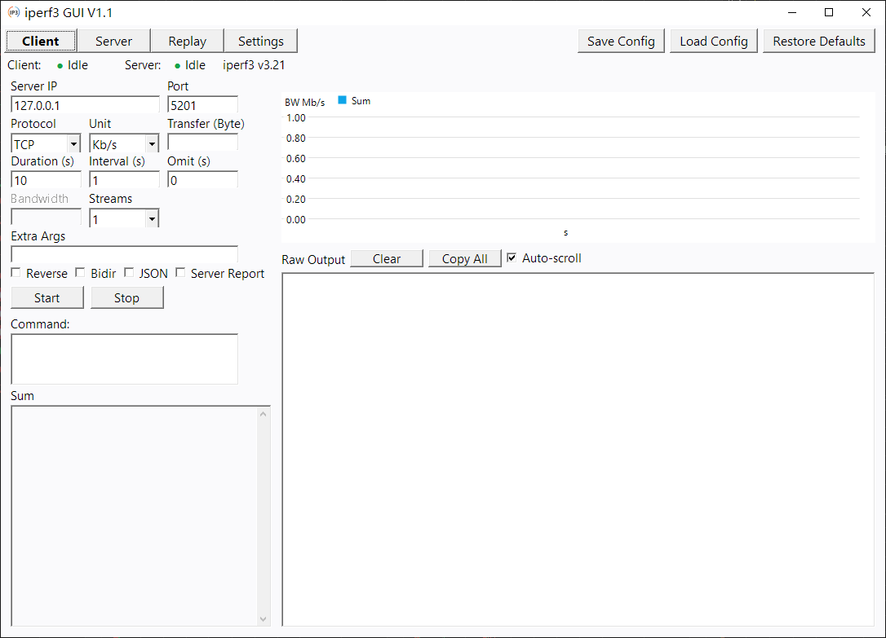
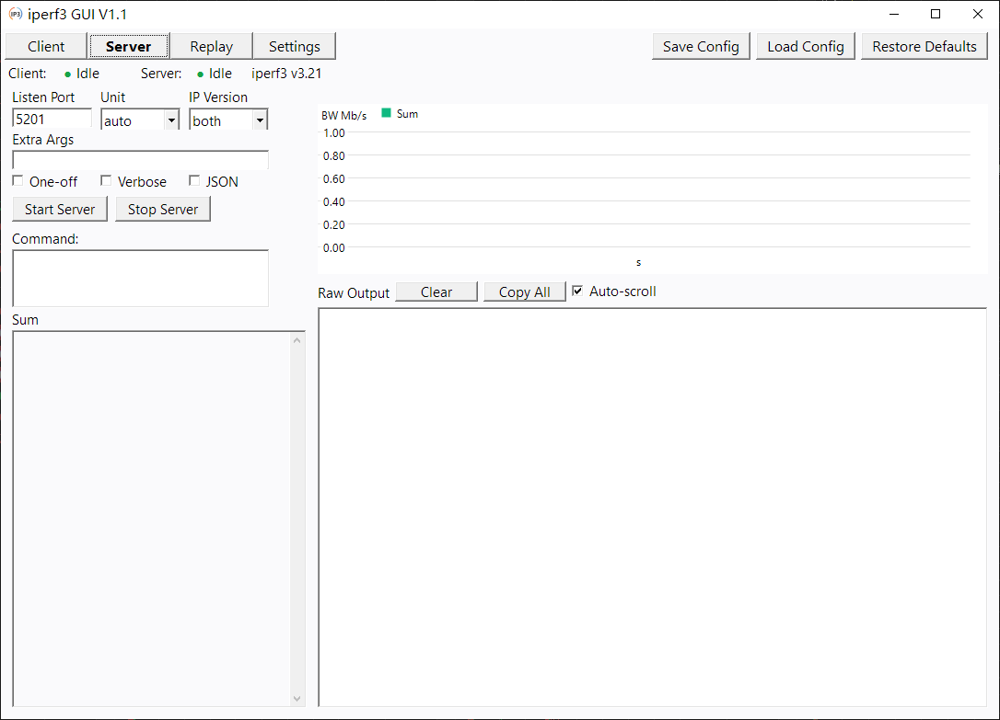
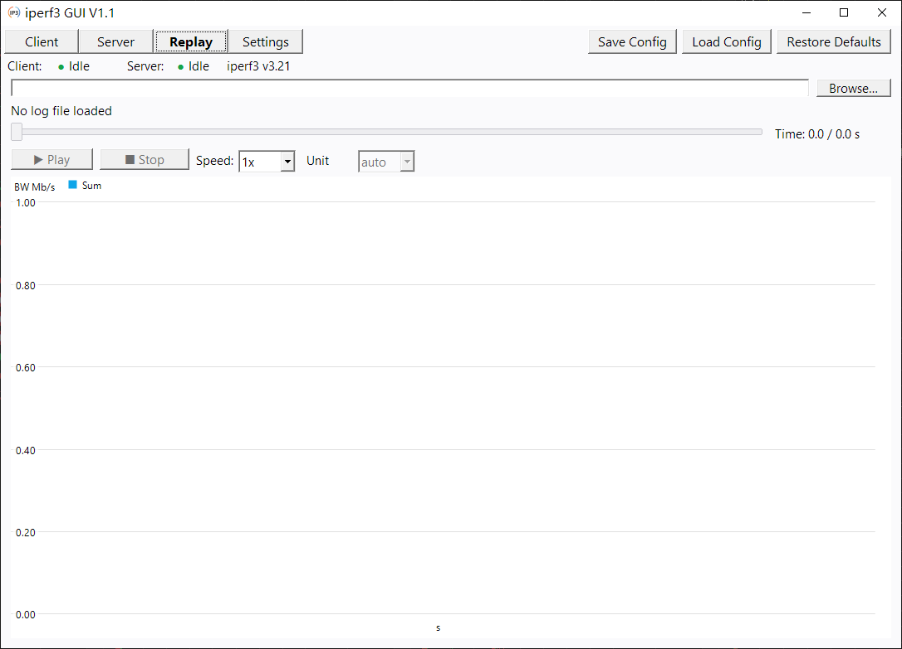
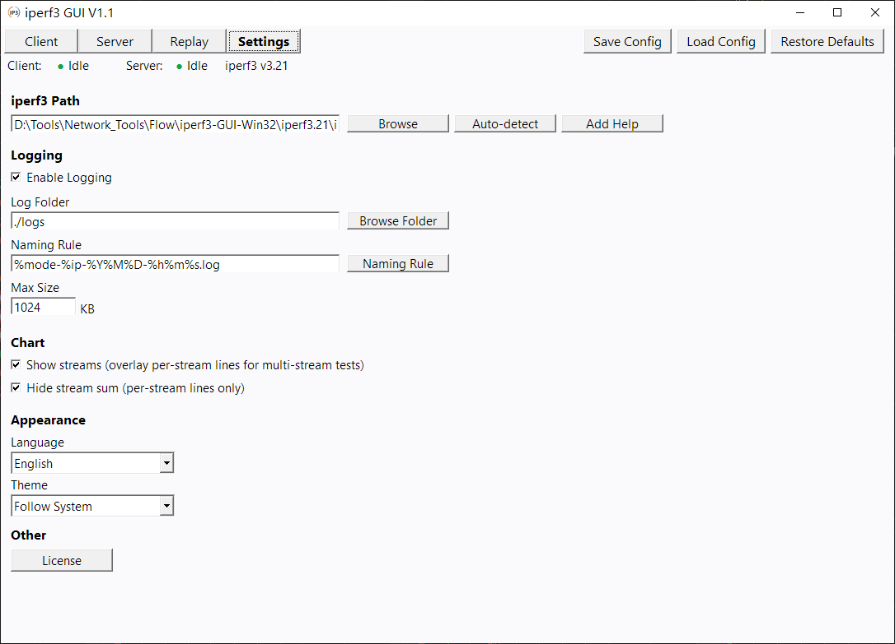

# iperf3 GUI V1.1

[English](README_EN.md) | 简体中文（本文件）

> 仓库有两份完整文档，**14 节逐节对应**：**README.md（简体中文）** 与 **README_EN.md（English）**。
> 改文档时**两处都要改**，否则会出现「某一节只在一种语言里」的漂移 ——
> 本文件此前就是只在顶部写了英文 Quick Start、14 节完整内容全是中文，现按此原则拆成两份。

纯 Win32 API + GDI+ 编写的 iperf3 图形界面，无任何 UI 框架依赖，编译后单一 exe（约 738 KB，静态链接 CRT）。

英文读者请前往 **[README_EN.md](README_EN.md)**。

---

## 截图

| 客户端 | 服务端 |
|---|---|
|  |  |

| 回放 | 设置 |
|---|---|
|  |  |

> 截图位于 `screenshots/`（与本文档同目录）。若你在仓库首页看到本文档，
> 图片路径以首页 README 的引用为准。

---

## 1. 功能

| 模块 | 能力 |
|---|---|
| 客户端 | 服务器 IP / 端口 / 协议 / 时长 / 间隔 / 并行流 / 缓冲区 / 带宽；反向 `-R`、双向 `--bidir`、JSON 输出、`--get-server-output` |
| 服务端 | 监听端口，仅一次 `-1`，详细输出 `-V` |
| 实时图表 | GDI+ 折线图 + 半透明填充；汇总粗线 + 各流细线（`-P n`）；UDP 右轴（抖动 / 丢包率 / 数据报）；bidir 双线（TX / RX） |
| 回放 | 载入历史日志，滑块逐区间回放，与实时同样的图表；「显示单位」下拉可切 9 档速率单位（默认 auto） |
| 原始输出 | RichEdit 终端风格，自动滚动 / 清空 / 复制 |
| 汇总解析 | 自动解析 sender / receiver 汇总，支持 bidir 双通道 |
| 国际化 | 简体中文 / 繁體中文 / English 三语（+「跟随系统」档） |
| 主题 | 跟随系统 / 深色 / 浅色 三档，标题栏跟随 DWM |
| 持久化 | 所有参数写 `settings.ini`（**exe 同目录**） |
| 日志 | 可选把测试输出落盘到 `logs/`，支持文件大小上限与命名模板 |
| iperf3 路径 | 自动检测 / 浏览选择 / 手动保存 |

---

## 2. 技术栈

| 组件 | 技术 |
|---|---|
| 语言 | C（main.c / iperf3.c / replay.c / lang.c）+ C++（chart.cpp，GDI+ 类） |
| GUI | Win32 API（CreateWindowEx + 消息循环），**无 v6 manifest**（经典控件绘制） |
| 绘图 | GDI+ |
| 编译器 | MinGW32 GCC 16.2.0 (i686)，装在 `C:\mingw32` |
| 富文本 | RichEdit 5.0（Msftedit.dll），回退 RichEdit 2.0 |
| 无依赖 | 不用 Electron / Qt / duilib / 任何 UI 框架 |

---

## 3. 目录结构

```
iperf3-GUI-Win32/
├── build.bat              编译脚本（windres + g++）
├── iperf3gui.exe          编译产物
├── iperf3gui.lnk          快捷方式
├── settings.ini           配置（与 exe 同目录，运行时生成/更新）
├── README/
│   ├── README.md          中文完整文档（本文件）
│   └── README_EN.md       英文完整文档（与中文逐节对应）
├── LICENSE                MIT 许可全文
├── logs/                  测试日志落盘目录（可选开启）　**不发布**
├── tools/                 iperf3.exe 及 Cygwin 运行时（**不随包分发，自备**）　**不发布**
│   ├── iperf3.exe         默认路径 `.\tools\iperf3.exe`
│   └── cygwin1.dll / cygcrypto-3.dll / cygz.dll
├── iperf3.21/             另一份 iperf3 3.21（当前 settings.ini 指向这里）　**不发布**
├── test/
│   ├── run_autotest.py    回归测试编排器（17 用例，自动起服务端）
│   ├── autotest.ini       用例参数（case_00 … case_16）
│   └── results/           运行产物：每用例 cmd/raw/summary + report.html　**不发布**
└── src/
    ├── main.c             主窗口 / 控件创建 / 事件 / 持久化 / i18n / 主题
    ├── iperf3.c           iperf3 进程管理 + 输出解析（含 JSON）
    ├── iperf3.h           数据结构与 API
    ├── chart.cpp          GDI+ 图表渲染（唯一 C++ 文件）
    ├── chart.h            ChartData 结构与图表 API
    ├── replay.c           回放：日志解析 + 逐区间推进
    ├── replay.h
    ├── lang.c             三语字符串表 kStr[]
    ├── lang.h             字符串枚举 + 语言/主题档位枚举
    ├── ui.h               AppState 全局状态 + 控件句柄
    ├── resource.h         控件 ID 定义
    ├── license_text.c     MIT 许可正文（三语摘要 + 恒英文条款）
    ├── help_text.c        「添加说明」正文（三语）
    ├── app.rc             资源脚本（图标 + VERSIONINFO）
    ├── app.ico            应用图标（多尺寸）
    └── app.res            编译产物（.rc → .res）　**不发布**
```

> 改源码前备份的文件（`*.c_备份_YYYYMMDD`、`README.md_备份_*`）按铁律保留在工作区，
> 确认无误后可手工删除。

#### 发布到 GitHub 时的取舍

上面标注 **不发布** 的项一律不进仓库，理由如下（体积为实测值）：

| 不发布项 | 实测 | 理由 |
|---|---|---|
| `tools/` + `iperf3.21/` | 各 8.9 MB，共 17.8 MB | 第三方二进制（iperf3 为 BSD-3-Clause，Cygwin 运行时另有其许可），与本项目 MIT 不同源 |
| `logs/*.log` | 含内网 IP 与端口（如 `192.168.x.x`） | 泄露内网拓扑与本机 IP |
| `settings.ini` | 含绝对路径 | 泄露本机目录结构 |
| `*_备份_*` | 6 个 | 工作习惯噪音 |
| `src/app.res`、`test/results/` | — | 构建 / 运行产物，每次重新生成 |
| `iperf3gui.exe`、`iperf3gui.lnk` | — | exe 改挂 GitHub Release 附件；lnk 含绝对路径 |

清洗后仓库约 **0.60 MB**（含源码、文档、回归脚本与截图）。
用户需自备 iperf3（≥ 3.7），获取方式见 [§10](#10-iperf3-版本要求)。

---

## 4. 编译方法

### 4.1 使用 build.bat（推荐）

```cmd
cd /d d:\Tools\Network_Tools\Flow\iperf3-GUI-Win32
build.bat
```

两步：
1. `windres src\app.rc -O coff -o src\app.res`
2. `g++`（8 个源文件 + app.res）→ `iperf3gui.exe`

### 4.2 手动编译（cmd，bat 内同款）

```cmd
C:\mingw32\bin\windres.exe src\app.rc -O coff -o src\app.res

C:\mingw32\bin\g++.exe -O2 -Wall ^
    -DUNICODE -D_UNICODE -DWIN32_LEAN_AND_MEAN ^
    src\main.c src\iperf3.c src\chart.cpp src\replay.c src\lang.c src\license_text.c src\help_text.c src\app.res ^
    -o iperf3gui.exe ^
    -lgdiplus -lcomctl32 -lcomdlg32 -lshlwapi -liphlpapi ^
    -luser32 -lkernel32 -lgdi32 -lshell32 -lole32 ^
    -mwindows -municode -static -static-libgcc
```

### 4.3 手动编译（bash / PowerShell 单行，无 `^` 续行）

```bash
C:/mingw32/bin/windres.exe src/app.rc -O coff -o src/app.res

C:/mingw32/bin/g++.exe -O2 -Wall -DUNICODE -D_UNICODE -DWIN32_LEAN_AND_MEAN \
  src/main.c src/iperf3.c src/chart.cpp src/replay.c src/lang.c src/license_text.c src/help_text.c src/app.res \
  -o iperf3gui.exe \
  -lgdiplus -lcomctl32 -lcomdlg32 -lshlwapi -liphlpapi -luser32 -lkernel32 -lgdi32 -lshell32 -lole32 \
  -mwindows -municode -static -static-libgcc
```

### 4.4 链接库

| 库 / 开关 | 用途 |
|---|---|
| gdiplus | GDI+ 图表绘制 |
| comctl32 | 通用控件 / 子类化（SetWindowSubclass） |
| comdlg32 | 文件选择对话框 |
| shlwapi | 路径操作 |
| iphlpapi | 端口占用检测（GetExtendedTcpTable） |
| shell32 / ole32 | Shell 与 COM 基础 |
| `-mwindows` | Windows 子系统（无控制台） |
| `-municode` | Unicode 入口（wWinMain） |
| `-static -static-libgcc` | 静态链接，无运行时依赖 |

> **`uxtheme` 已于 2026-09-23 移除**（无 v6 manifest 时 `SetWindowTheme` 是空操作，`-luxtheme` 及相关死代码已删干净）。

### 4.5 当前 warning 基线

`-Wall -Wextra` 下新增项：**main.c 2 个 unused parameter**（`textLen`、`hPrev`），其余文件 0。另有若干 `-Wstringop-truncation`（`strncpy` 长度与源串等长，属已知且无害）。**改动后不应新增。**

> 单用 `-Wall`（`build.bat` 与 README §4.2 的档位）**不会**报 unused parameter —— 要复现基线必须带 `-Wextra`。

### 4.6 判断 exe 是否真的重新生成

**不要用 md5，也不要只看大小**：
- 同一份源码编译两次 md5 也不同（PE 头带时间戳）；
- 多次改动后大小会撞车（例如几版都恰好 736007 B）。

**以 mtime 为准。**

---

## 5. settings.ini

**位置：exe 同目录**（`GetModuleFileNameA` 取目录 + `\settings.ini`）。旧文档写的 `%APPDATA%\iperf3gui\` 是**错的**。

| 段 | 键 | 说明 |
|---|---|---|
| `[client]` | `ip` `port` `proto` `duration` `interval` `format` `num` `omit` `bw` `extra` `parallel` `reverse` `bidir` `json` `getserveroutput` | 客户端参数，点「应用」或退出时保存 |
| `[server]` | `port` `format` `af` `extra` `oneoff` `verbose` `json` | 服务端参数 |
| `[settings]` | `iperf3Path` | iperf3.exe 路径，默认 `.\tools\iperf3.exe` |
| `[log]` | `Enabled` `Dir` `Naming` `MaxSizeKB` | 日志落盘；`Naming` 支持 `%mode` `%ip` `%Y%M%D` `%h%m%s` |
| `[UI]` | `Theme` = `auto`\|`dark`\|`light`、`Language` = 语言档位 | 主题与语言。段由「恢复默认」或退出保存时写入 |
| `[Chart]` | `ShowStreams`（显示各流细线）、`HideStreamSum`（多流时隐藏汇总） | 默认均 `0`；`HideStreamSum` 仅在 `ShowStreams=1` 时生效 |
| `[replay]` | `unit` = `0`–`8` | 回放显示单位档位下标（`0`=Kb/s `1`=Mb/s `2`=Gb/s `3`=Tb/s `4`=KB/s `5`=MB/s `6`=GB/s `7`=TB/s `8`=auto，默认 `8`）。auto 等价于 Mb/s |

> 注：`WritePrivateProfileString` 会**原样保留**文件中已有的空行，既不自愈也不恶化。历史遗留的空行只能手工压实。

---

## 6. 回归测试

编排器会**自动拉起 iperf3 服务端**（iperf3 3.x 的 `-s` 可连续服务多个客户端，已实测确认），
无需手工开服务端：

```bash
python test/run_autotest.py --duration 5
```

| 项 | 值 |
|---|---|
| 用例数 | 17（`case_00` … `case_16`），矩阵覆盖 TCP/UDP × `-f` 单位 × 正向/反向/bidir × JSON 开关 × 服务端 one-off/verbose |
| **实测基线** | **16 PASS / 0 WARN / 1 FAIL**（2026-10-16，iperf3 3.21 Cygwin 版，回环，duration=5）。FAIL = `case_05` UDP bidir，属 iperf3 侧限制，见下 |
| 原理 | 编排器按用例重写 `test/autotest.ini`（GUI 固定读 exe 同目录的该文件且总从 `case_00` 起跑，跑完还原）→ 启动 `iperf3gui.exe --autotest`（隐藏窗口）→ 解析 `test/results/` 下每用例的 `cmd` / `raw` / `summary` 三个 dump → 判定 PASS/WARN/FAIL → 生成 `test/results/report.html` |
| 判定 | ① dump 缺失/为空；② 原始输出出现 `[error]`；③ 文本模式必须有区间/汇总行；④ 汇总框锚点（客户端 `[发送]`，服务端 `[接收]`）；⑤ **数值交叉校验**——汇总框速率与原始输出 `[SUM] … sender` 换算到 bps 后比对，容差 2% |
| 可选参数 | `--duration`、`--server-ip`、`--server-port`、`--start-case N`、`--max-cases N`、`--no-server` |

**两条环境约束**（2026-10-16 实机验证）：

1. **界面语言必须是简体中文。** 编排器以窗口文本 `[发送]` / `[接收]` / `方向:` 为锚点；繁体是「傳送」、英文是 `[Sender]`。
   语言不对会被明确报出（不会默默全红）。语言档位存在 `settings.ini` 的 `[UI] Language`。
2. **UDP 用例一律 `parallel=1`。** Cygwin 版 iperf3 3.21 在 `-u` 叠加 `-P>1` 时会直接报
   `unable to read from stream socket: Resource temporarily unavailable` 并退出码 1（`-P 2/4/8` 均复现，`-P 1` 正常）。
   这是 **iperf3 侧的限制，不是 GUI 缺陷**，故 UDP 多流不在回归矩阵内。

#### 已知 FAIL：`case_05` UDP + `--bidir`

**不是 GUI 缺陷。** 脱离 GUI 用裸命令行同样复现：

```cmd
iperf3.exe -s -p 15211
iperf3.exe -c 127.0.0.1 -p 15211 -u -t 3 --bidir
  → iperf3: error - unable to read from stream socket: Resource temporarily unavailable
```

对照实验（同一台机器、同一个 exe）：

| 组合 | 结果 |
|---|---|
| `-u -t 3`（纯 UDP） | 正常 |
| `-u -t 3 -R`（UDP 反向） | 正常 |
| `-u -t 3 -b 10M --bidir` | 同样失败（与带宽无关） |
| `-u -t 6 --bidir` | 同样失败（与时长无关） |
| `-t 3 --bidir`（TCP bidir） | 正常 |

服务端日志显示 `Accepted connection` 之后客户端就报读控制 socket 失败 —— 卡在 iperf3 自己的控制通道握手，
GUI 尚未参与解析。因此该用例的 FAIL 归因为 **iperf3 3.21 Cygwin 版不支持 UDP + bidir**，不计入 GUI 回归门禁。

用例的 `parallel` 必须显式写：AutoTest 若不指定就会沿用 `settings.ini` 里用户上次的值（如 `parallel=8`），
结果会随用户配置漂移。GUI 侧已按 `parallel` 键设置多流下拉（`CB_SETCURSEL, parallel-1`，钳在 1–8）。

---

## 7. 源码模块职责

| 文件 | 行数 | 职责 |
|---|---|---|
| `main.c` | 5487 | 主窗口、四个面板控件创建与布局（`CreateAllControls`）、`UI_SwitchTab`、消息处理、参数持久化（LoadAll/SaveAll/InitDefault/RestoreDefaults）、主题应用 `Theme_Apply`、i18n 应用、深色化子类、回放 UI 接线 |
| `iperf3.c` | 1067 | 组装命令行、`CreateProcess` 启动子进程、匿名管道读取、文本与 JSON 两条解析路径 |
| `chart.cpp` | 735 | GDI+ 绘制：坐标轴、网格、汇总线/面积、各流细线、UDP 右轴、图例（含点击切换显隐）、量程 `niceMax` |
| `replay.c` | 448 | 解析历史日志为区间数组，滑块/播放推进，喂给同一套 `ChartData` |
| `lang.c` / `lang.h` | 243 / 193 | 三语字符串表 `kStr[]`（138 项）与枚举；语言档位、主题档位 |
| `license_text.c` / `help_text.c` | 85 / 52 | MIT 正文（三语摘要 + 恒英文条款）、说明正文（三语各一份） |
| `ui.h` | 193 | `AppState` 全局状态 + 全部控件句柄 |
| `resource.h` | 137 | 控件 ID 分段（见下） |

---

## 8. 控件 ID 分段（`resource.h`）

| 段 | 范围 | 说明 |
|---|---|---|
| Tab 按钮 | 1001–1004 | 客户端 / 服务端 / 回放 / 设置 |
| 全局按钮 | 1005–1007 | 保存配置 / 加载配置 / 恢复默认 |
| 客户端面板 | 1100–1129 | 输入、复选框、命令框、输出框、图表窗口、汇总标签 |
| 服务端面板 | 1200–1215 | 端口、one-off、verbose、输出等 |
| 设置面板 | 1300–1329 | 路径、浏览/检测、日志项、**1314 显示各流、1316 语言下拉、1317 主题下拉、1318 隐藏流汇总、1321 添加说明、1326 License** |
| 回放面板 | 1500–1511 | 路径 / 浏览 / 信息 / 滑块 / 时间 / 播放 / 停止 / 倍速 / **显示单位(1511)** / 数值 / 图表（`1500`–`1511`） |
| 状态栏 | 1401–1408 | 客户端、服务端两段（标签 + 圆点 + 状态值）+ 复制提示 |
| 自定义消息 | — | `WM_PIPE_LINE`(WM_USER+100) / `WM_PIPE_DONE`(+101)、`WM_AUTOTEST_NEXT`(+200) / `WM_AUTOTEST_DONE`(+201) |

> 回放面板是 1500 段，不是 1400 段；1400 段留给状态栏。定时器 `REPLAY_TIMER_ID = 1001`（与 Tab 按钮 ID 同值但不同命名空间）。

---

## 9. 开发铁律（改代码前必读）

### 9.1 解析铁律（改错 ⇒ 图表空白）

- **汇总行判据 = `direction[0] != 0`**（区间行没有 sender/receiver）。**不可**用 `- - - -` 分隔线判断。
- **bidir 禁用 `streamId == -1` 过滤**：单对流时 iperf3 不打 `[SUM]`，加了过滤曲线会全空。
- 服务端新连接**只认 `"Accepted connection from"`**。
- 图例是 GDI+ 自绘 ⇒ 切语言 / 切主题后**必须 `InvalidateRect`**。
- 多流（`-P n`）区间行到达顺序是 `[4] [7] … [19] [SUM]`：**新区间第一个点必须用上一区间的汇总值做种子**，等 `[SUM]` 到达再覆盖，否则曲线头部会下扎到单流值（约总量 1/N）。bidir 分支同理。

### 9.2 深色化（无 v6 manifest 的约束）

- `SetWindowTheme` **是空操作**；普通 push button **不吃 `WM_CTLCOLORBTN`** ⇒ 深色按钮必须 `BS_OWNERDRAW` + `WM_DRAWITEM`。
- Combo 下拉箭头 `rcButton` **已是客户区坐标**。
- 控件边框画在客户区 ⇒ 用 `FieldChromeSubclass` 重涂。
- 多行命令框是 RichEdit：背景用 `EM_SETBKGNDCOLOR`，**字色必须 `EM_SETCHARFORMAT`**。
- 标题栏：`DWMWA_USE_IMMERSIVE_DARK_MODE`（20，19 为旧值）。**标题栏字体改不了**（DWM 绘制）。
- `[UI] Theme=auto|dark|light`；`themeSel`（档位）与 `isDark`（生效）**必须分离**。
- **ComboBox 下拉列表的滚动条暗色 = 做不到，已放弃**：`WM_CTLCOLORSCROLLBAR` 对 ListBox 自带滚动条根本不发。相关死代码已删，别再试这条路。

### 9.3 语言表

- `lang.h` 枚举是**显式数字**，`lang.c` 的 `kStr[]` 是**按位置索引**的数组 —— 两者**必须严格同序**。删中间任一项要重排后面全部编号，错一位就是全局文案错乱。**新增只能追加到末尾。**
- 语言表同一行的**三列必须都填**（否则「简体中文」会在繁体界面显示成繁体）。
- 语言下拉第 1~3 项是 `main.c` 里的**固定字面量，不经 `T()`**；只有第 0 项「跟随系统」随界面语言翻译。
- 主题下拉三项**全随界面语言翻**（切语言时逐项替换 0/1/2）。**与语言下拉方向相反，别互相照抄。**
- 图例宽度**不要写死**：用 `MeasureString` 按当前语言实测（英文比中文宽得多，写死会重叠）。

### 9.4 跨进程 UI 验证（32 位 exe + 64 位 Python）

- `SendMessage` **不封送指针** ⇒ 读 combo 项只能用 `CB_GETLBTEXTLEN`（`CB_GETLBTEXT` 恒返回 `CB_ERR`）。
- 触发真实切换 = `CB_SETCURSEL` + 把 `WM_COMMAND(MAKEWPARAM(id, CBN_SELCHANGE))` 发给 **combo 的父窗口**。
- ctypes 调用**必须显式写 `argtypes`**，否则句柄被截断、`ReadProcessMemory` 静默读全零。
- 纯文本校验可用 UTF-16LE 二进制子串搜索。

### 9.5 新增一个设置项要接 4 处

`SaveAllConfig` / `LoadAllConfig` / `InitDefaults` / `RestoreAllDefaults` —— 漏一处就会出现「重启后丢设置」或「恢复默认没生效」。

---

## 10. iperf3 版本要求

| 功能 | 最低版本 |
|---|---|
| 基本测试 | iperf3 3.0+ |
| `--bidir` 双向 | 3.7+ |
| `[Role]` 字段（TX-C / RX-C） | 3.17+ |

iperf3 的查找顺序（`FindIperf3`，先命中者胜）：① 本程序所在目录及其子目录（按层 BFS，跳过重解析点）；② 系统 `PATH` 中的目录（不含子目录）。
「自动检测」即按此顺序查找，也可用「浏览」手动指定。版本低于 3.7 时勾选「双向」会提示但不阻止运行。

bidir 模式下 iperf3 v3.21 的输出格式：单条分隔线后跟 4 行汇总（TX-C sender/receiver + RX-C sender/receiver），程序通过 `[Role]` 字段区分前向 / 反向通道。

---

## 11. 360 安全卫士误报

MinGW 静态编译的 exe 无数字签名，且程序会 `CreateProcess` 启动 iperf3.exe、重定向管道、写文件，可能触发 360 启发式检测。处理：

1. 把 `iperf3gui.exe` 加入 360 信任区；
2. 到 https://soft.360.cn/report/ 提交误报申诉（通常 1-3 天）；
3. `app.rc` 已含 VERSIONINFO（CompanyName / ProductName / FileVersion），右键 exe → 属性 → 详细信息可查看。

---

## 12. 架构

### 12.1 进程模型

- `CreateProcessA` 启动 iperf3.exe 子进程；
- stdout 与 stderr **合并进同一根可继承匿名管道**（64 KB，`CreatePipe` + `STARTF_USESTDHANDLES`）；
- 命令行里**内部追加 `--forceflush`**（iperf3 3.7+），强制每区间 `fflush(stdout)`；
  没有它，C 运行时在 stdout 不是控制台时会切到 4 KB 全缓冲，管道收不到实时数据；
  **`--forceflush` 不出现在界面显示的命令行里**（`BuildCommandLine` 的 display 与 exec 两份参数是分开的）；
- `PipeReaderThread` 用 8 KB 缓冲按 `\n` 切行、剥掉 `\r`，逐行 `PostMessageW(WM_PIPE_LINE)` 给主线程，进程退出发 `WM_PIPE_DONE`；
- 每行走 `OnProcessLine` → `OnIperf3Line` 解析（行首是 `{` 走 JSON 状态机，否则走文本解析）。

> 旧版本曾用 `--logfile` 落临时文件 + 200 ms 定时器 tail 的方案（`TIMER_CLIENT_TAIL` / `TIMER_SERVER_TAIL` / `TailLineCallback`），
> 现已全部移除，源码里搜不到这些符号。文档此处同步更正。

### 12.2 图表渲染

`chart.cpp` 在子窗口 `WM_PAINT` 中用 GDI+ 绘制：

- 折线 + 半透明填充；蓝色 = 客户端，绿色 = 服务端；
- `ChartData` 独立于 `AppState`，客户端 / 服务端 / 回放各一份；
- 三档数据源：`values[]`（汇总，bidir 时为 TX）、`values2[]`（bidir 的 RX）、`series[i]`（各流细线）；
- Y 量程：默认按 `values[]`；隐藏汇总时改扫各可见 `series[]` 取最大值（否则细线会全挤在底部 1/N）；
- 图例自绘，点击可切换各流显隐；英文等宽文本靠 `MeasureString` 实测排布。

### 12.3 主题

- 读注册表 `HKCU\Software\Microsoft\Windows\Themes\Personalize\AppsUseLightTheme` 判断系统主题；
- 设置页下拉三档（`auto` / `dark` / `light`）覆盖；
- 切换时 `Theme_Apply` 走 `EnumChildWindows`（递归）+ `RedrawWindow` 全量重刷，孙控件（如回放滑块）也命中，新增控件无需额外接线；
- 颜色分浅 / 深两套独立分支，**改浅色时不要误伤深色**。

---

### 12.4 回放显示单位与「当前值」

回放页 Row 4 在「倍速」之后有「显示单位」下拉（`CBO_REPLAY_UNIT=1511`），9 档与客户端/服务端页逐字一致。

数据流（`unit` / `yScale` 一路传到底，无需重新解析日志）：

```
CBO_REPLAY_UNIT (CBN_SELCHANGE)
  → Replay_ReadUnit()      写 g_state.replay.unit / .yScale
  → Replay_ApplyIndex(idx) → Replay_Seek()  每次定位都把 unit/yScale 拷进 ChartData
  → chart.cpp              用 cd->yUnit 画 Y 轴标题、cd->yScale 除所有点
```

同时「当前:」数值行走 `Replay_FormatRate()`，按选定档位换算（D1）。

> **决策记录（2026-10-16，用户拍板）：汇总框不跟随 `-f`。**
> 汇总框速率由 iperf3 原始 bps 经 `FormatSpeed()` 自动分档（G/M/K/bps）后显示，**不随 `-f`
> 改变单位表达**；而图表 Y 轴与原始输出**是跟随 `-f` 的**。因此回放的数值行刻意**不走共用
> `FormatSpeed()`**（改它会波及汇总框），改用本地的 `Replay_FormatRate()`。
> 这是产品决策，不是缺陷 —— 别顺手「修」成一致。

---

## 13. 许可证

本程序（iperf3 GUI）以 **MIT License** 授权，版权 **Copyright (c) 2026 BenjmSek**。

- 完整条款见仓库根目录 `LICENSE`；程序内「License」对话框内置同一份英文原文（三语摘要 + 恒英文条款）。
- 本程序**不包含也不分发** iperf3 及其运行时依赖（`cygwin1.dll` 等）。用户需自行获取 iperf3（≥ 3.7）供本程序调用。
- iperf3 自身采用 BSD-3-Clause（ESnet/LLNL），与本程序的 MIT 授权相互独立。

## 14. 变更记录

| 项 | 内容 |
|---|---|
| 字号 | Tab 按钮 7 个 → 22px（`s_hFontGroupNormal` / 选中 `s_hFontGroup`）；状态栏 6 个控件回到 `CreateLabel` 默认 20px，删除随 Tab 动态加粗逻辑 |
| 回放滑块 | 新增 `SliderThemeSubclass` + `PaintReplaySlider` 自绘，浅色主题下跟随变浅（深色分支保持深色，无白底） |
| 曲线头部 | 多流实时汇总「头部向下」修复：新点改用上一区间汇总值做种子，覆盖非 bidir 与 bidir 两条分支 |
| 新选项 | 设置页新增「隐藏流汇总」（`CHK_HIDE_STREAM_SUM=1318`），未勾「显示各流」时置灰；生效后不画汇总线/面积/图例项，Y 量程改按各流取最大值 |
| 图例 | 6 处写死宽度改为 `MeasureString` 实测；英文文案 `Summary`→`Sum`、`Stream`→`STRM`、`Bandwidth`→`BW` |
| 死代码 | 删 `JsonGetBool()`、`seriesName[]`、`LBL_SETTINGS_DETECTED`；修正 `chart.h` 过时注释与 `main.c` 段落标题 |
| 清理 | 临时文件 / 备份 / 一次性探针已清（`test/` 仅保留 `run_autotest.py` + `autotest.ini`） |

### 2026-10-16

| 项 | 内容 |
|---|---|
| 许可证 | 统一为 **MIT License**（原 `license_text.c` 声明 BSD-3-Clause 与 `app.rc` 的 "MIT License" 自相矛盾，现一致）。对话框正文、三语摘要、条款原文全部替换为 MIT |
| 署名 | `2BorNot2B` → **BenjmSek**（窗口标题、VERSIONINFO、License 对话框、README） |
| 默认 IP | `DEF_CLIENT_IP` 由内网地址改为 **`127.0.0.1`**（含控件初值与帮助文本示例） |
| 文档 | README 拆为 `README.md`（中文）与 `README_EN.md`（英文）**两份完整文档**；此前英文只有顶部 Quick Start，14 节完整内容缺英文版 |
| 回归测试 | 重建 `test/autotest.ini`（17 用例）+ `test/run_autotest.py` 编排器；实测 16 PASS / 0 WARN / 1 FAIL |
| 回归环境 | AutoTest 新增 `parallel` 用例键（此前沿用 `settings.ini` 的并发数，结果随用户配置漂移）；UDP 用例一律 `parallel=1` |
| 回放单位 | 回放页新增「显示单位」下拉 `CBO_REPLAY_UNIT=1511`（9 档，默认 auto=Mb/s），存 `[replay] unit`；「当前:」数值行同步跟随 |
| 文档更正 | §12.1 进程模型（旧版 `--logfile` + tail 方案已移除）、§5 settings.ini 路径、§7 行数、§10 查找顺序、§3 目录树 |
